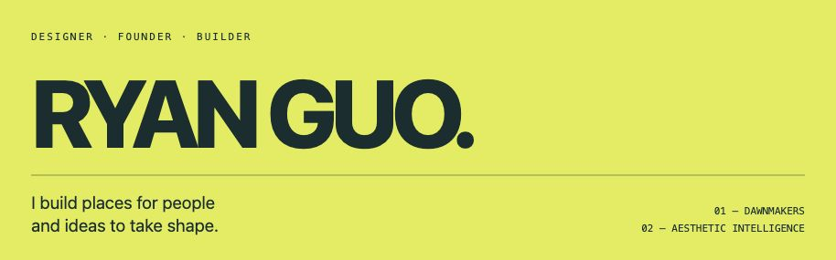
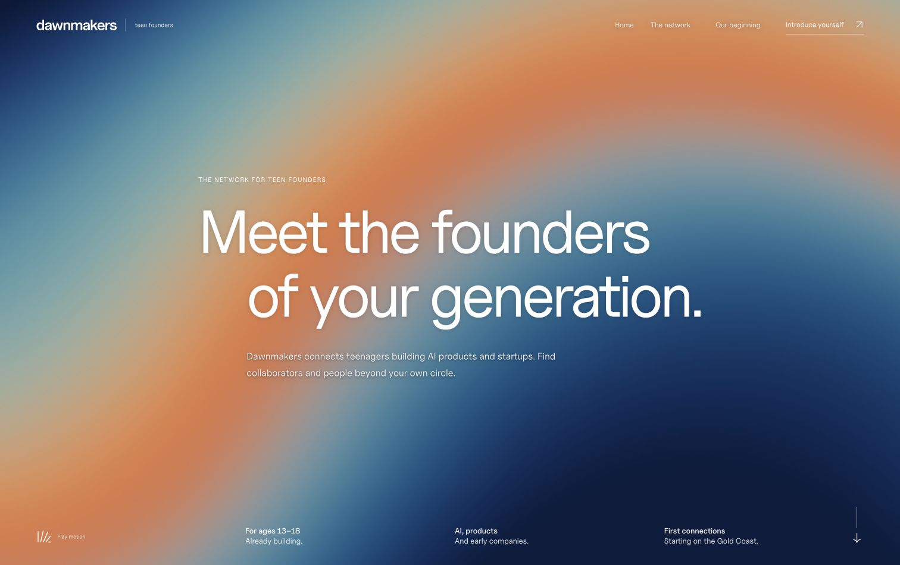
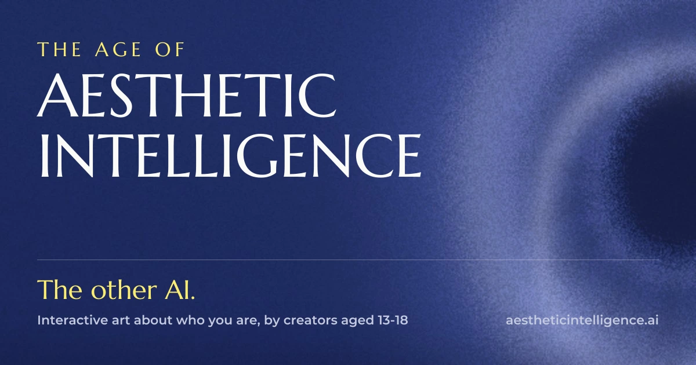
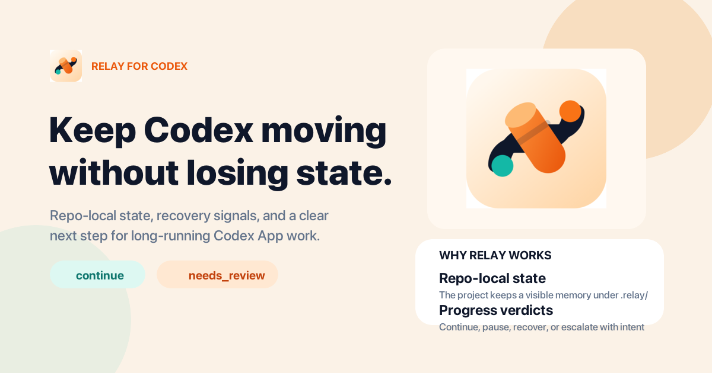
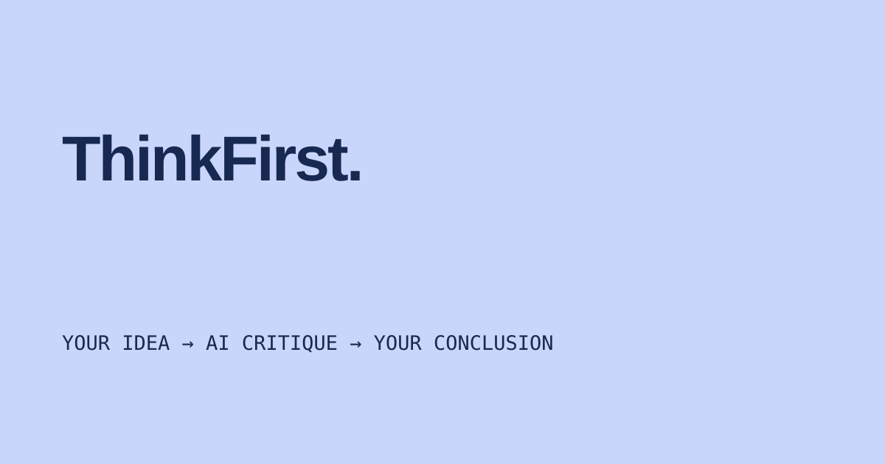
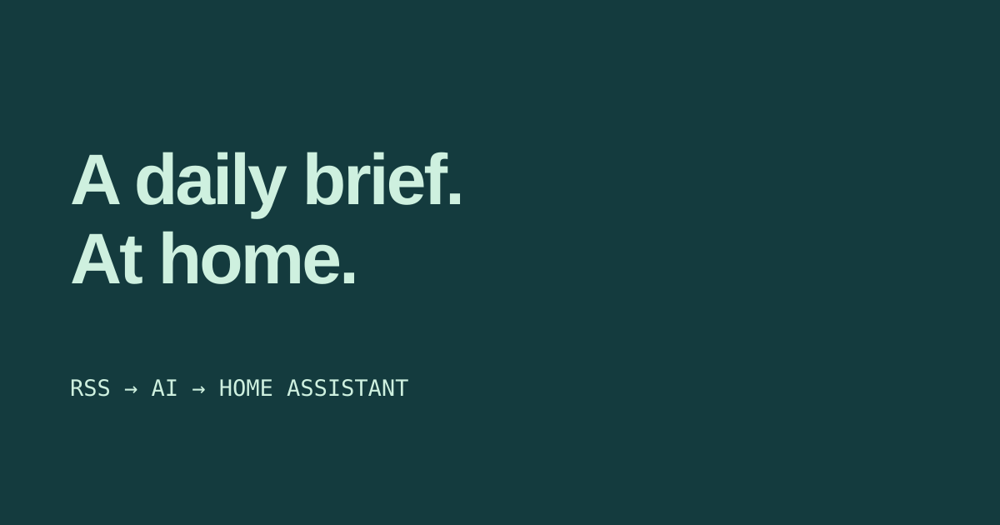
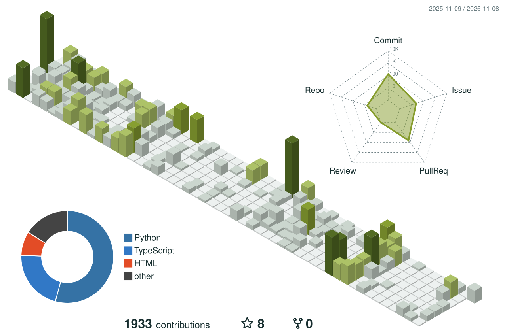

Currently building **Dawnmakers** and **The Age of Aesthetic Intelligence**.

## Dawnmakers

A network for teen founders building AI products and startups. Find collaborators and people beyond your own circle.

**Co-founder · Product & experience design**

[Explore Dawnmakers ↗](https://dawnmakers.ryan-guo.com/)

## The Age of Aesthetic Intelligence

Exploring human judgment and creativity through art, research and collaboration. Developing **Who Am I?**, its first interactive art exhibition.

**Founder · Creative direction & development**  
Platform & exhibition in development.

[Explore the platform ↗](https://www.aestheticintelligence.ai/)

## Also built

<table>
<tr>
<th width="33%">Relay for Codex</th>
<th width="33%">ThinkFirst</th>
<th width="33%">HA AI Daily Brief</th>
</tr>
<tr>
<td width="33%"></td>
<td width="33%"></td>
<td width="33%"></td>
</tr>
<tr>
<td>Reviewable handoffs for AI coding work.</td>
<td>A Socratic AI coaching prototype.</td>
<td>RSS news briefings through Home Assistant.</td>
</tr>
<tr>
<td><a href="https://github.com/Ryan-Guo123/relay-codex">Source ↗</a></td>
<td><a href="https://github.com/Ryan-Guo123/ThinkFirst">Source ↗</a></td>
<td><a href="https://github.com/Ryan-Guo123/ha-ai-daily-brief">Source ↗</a></td>
</tr>
</table>

## Building, day by day

<picture>
  <source media="(prefers-color-scheme: dark)" srcset="./profile-3d-contrib/profile-night-green.svg">
  <source media="(prefers-color-scheme: light)" srcset="./profile-3d-contrib/profile-green.svg">
  
</picture>
