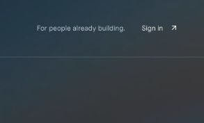

Currently building **Dawnmakers** and **The Age of Aesthetic Intelligence**.

## Dawnmakers

A network for teen founders building AI products and startups. Find collaborators and people beyond your own circle.

**Co-founder · Product & experience design**

[Explore Dawnmakers ↗](https://dawnmakers.ryan-guo.com/)

## The Age of Aesthetic Intelligence

Exploring human judgment and creativity through art, research and collaboration. Developing **Who Am I?**, its first interactive art exhibition.

**Founder · Creative direction & development**  
Platform & exhibition in development.

[Explore the platform ↗](https://www.aestheticintelligence.ai/)

## Also built

| Relay for Codex | ThinkFirst | HA AI Daily Brief |
| --- | --- | --- |
|  |  |  |
| Reviewable handoffs for AI coding work. | A Socratic AI coaching prototype. | RSS news briefings through Home Assistant. |
| [Source ↗](https://github.com/Ryan-Guo123/relay-codex) | [Source ↗](https://github.com/Ryan-Guo123/ThinkFirst) | [Source ↗](https://github.com/Ryan-Guo123/ha-ai-daily-brief) |
