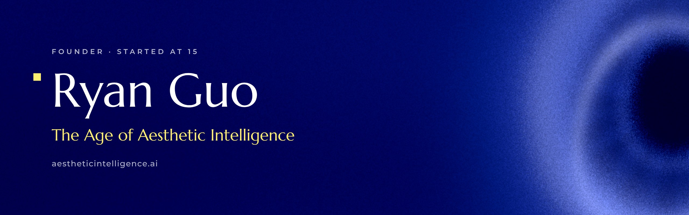

 

I'm Ryan. I started **The Age of Aesthetic Intelligence** when I was 15.

It's an art and cultural platform about how people notice, judge, choose and make meaning while technology keeps changing. We call that ability aesthetic intelligence: the other AI. I think it's the most important thing a person can have right now, and it stays yours whatever tools you use.

[ryan-guo.com](https://ryan-guo.com) &nbsp;·&nbsp;
[aestheticintelligence.ai](https://www.aestheticintelligence.ai/?utm_source=github&utm_medium=social) &nbsp;·&nbsp;
[Instagram](https://www.instagram.com/aestheticintelligence.ai/) &nbsp;·&nbsp;
[YouTube](https://www.youtube.com/@TheAgeofAestheticIntelligence) &nbsp;·&nbsp;
[LinkedIn](https://www.linkedin.com/in/ryan-guo123/) &nbsp;·&nbsp;
[hello@ryan-guo.com](mailto:hello@ryan-guo.com)

 

### The Age of Aesthetic Intelligence: Who Am I?

Our first project is a global touring exhibition of interactive art made by creators aged 13-18.

My generation is the first to grow up with AI. It can make almost anything, and sometimes that makes it harder to tell what's really ours. So the old question comes back: who am I? The exhibition asks teens to answer it in their own work, using AI as one tool among many, with their own eye.

- Free from start to finish, and open to creators aged 13-18 anywhere in the world.
- Selected creators get a production grant of up to US$2,000 to finish their work, and compete for awards of up to US$10,000.
- Selected works are shown online and in art museums around the world.

**[Take part →](https://www.aestheticintelligence.ai/who-am-i?utm_source=github&utm_medium=social)**

 

### Building it

I build the website with AI coding agents. It runs on Next.js, React and WebGL.

The platform has more than US$25,000 in donated software, hardware and services from companies including Canva and monday.com, and is fiscally sponsored by [The Hack Foundation](https://hcb.hackclub.com/latent-hacks). It was previously called Latent Hacks.

 

### Other things I've made

- [**ThinkFirst**](https://github.com/Ryan-Guo123/ThinkFirst): a Socratic AI coach that questions your reasoning instead of doing the work for you. Live at [thinkfirstapp.com](https://www.thinkfirstapp.com/).
- [**relay-codex**](https://github.com/Ryan-Guo123/relay-codex): handoff notes on GitHub for long-running AI coding work.
- [**project-as-school**](https://github.com/Ryan-Guo123/project-as-school): a school model where each term is one real project.
- [**ha-ai-daily-brief**](https://github.com/Ryan-Guo123/ha-ai-daily-brief): a Home Assistant integration that turns your RSS feeds into a spoken daily news brief.
